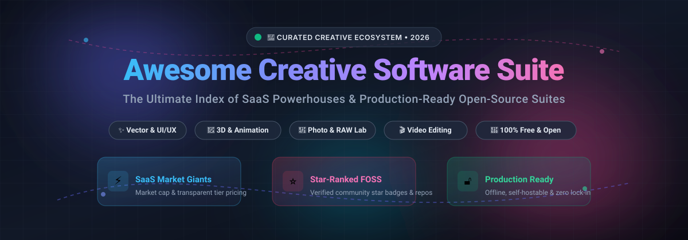

# 🎨 Awesome Creative Software Suite

<p align="center">
  
</p>

<p align="center">
  <a href="https://github.com/ishandutta2007/Awesome-Awesome-Awesome"></a><a href="https://discord.gg/jc4xtF58Ve"></a>
  <a href="https://github.com/ishandutta2007/Awesome-Creative-Software-Suite/stargazers"></a>
  <a href="https://github.com/ishandutta2007/Awesome-Creative-Software-Suite/network/members"></a>
  <a href="https://github.com/ishandutta2007/Awesome-Creative-Software-Suite/issues"></a>
  <a href="https://github.com/ishandutta2007/Awesome-Creative-Software-Suite/blob/main/LICENSE"></a>
  <a href="https://github.com/ishandutta2007"></a>
</p>

---

## 🌟 Overview & Highlights
Welcome to the **Awesome Creative Software Suite** — a comprehensive, SEO-optimized curated index tracking elite **cloud SaaS platforms** and **production-grade open-source software (FOSS)** across graphic design, vector illustration, digital painting, photo retouching, RAW development, UI/UX prototyping, 3D modeling, VFX, and video editing workflows.

Whether you are looking for enterprise cloud collaboration, independent creative tools, or privacy-preserving self-hosted creative suites, this repository provides deep comparative intelligence on pricing tiers, free trial limits, market valuations, and GitHub community traction.

---

## 📑 Table of Contents
- [📊 Sector Overview & Market Dynamics](#-sector-overview--market-dynamics)
- [☁️ SaaS & Hosted Creative Platforms](#️-saas--hosted-creative-platforms)
- [🚀 Open-Source GitHub Projects](#-open-source-github-projects)
- [🛠️ Recommended Creative Workstations](#️-recommended-creative-workstations)
- [🤝 How to Contribute](#-how-to-contribute)
- [💖 Support & Sponsorship](#-support--sponsorship)
- [📈 Star History](#-star-history)
- [⚖️ Disclaimer](#️-disclaimer)

---

## 📊 Sector Overview & Market Dynamics
The global creative software and digital content creation market is estimated at **$15.2 billion in 2024–2025** and is projected to expand to **$32.5 billion by 2032** at a Compound Annual Growth Rate (CAGR) of approximately 11.2%. The industry demonstrates a **moderately to highly concentrated structure** dominated by massive category champions (notably Adobe, Autodesk, and Canva), but features vigorous competitive fragmentation across specialized niches like collaborative UI/UX design (Figma), high-velocity web content generation, and an exceptionally capable, vibrant open-source ecosystem (Blender, Penpot, Krita, GIMP).

---

## ☁️ SaaS & Hosted Creative Platforms

The table below lists category-leading SaaS creative software suites, ordered by company size (valuation / market capitalization in descending order).

| Product | Focus & Core Capabilities | Company Size / Valuation | Starting Tier Price | Free Tier / Trial Limit |
| :--- | :--- | :--- | :--- | :--- |
| **[Adobe Creative Cloud](https://www.adobe.com/creativecloud.html)** | 🎨 Comprehensive industry-standard suite covering Photoshop, Illustrator, Premiere Pro, InDesign, and After Effects | **~$220 Billion** (Market Cap, NASDAQ: ADBE) | $59.99/mo (All Apps plan) or $22.99/mo (Single App plan) | **7-day free trial** with full access to all desktop apps, cloud storage (100 GB), and Adobe Fonts |
| **[Autodesk Creative Tools](https://www.autodesk.com/)** | 🧊 High-end 3D animation, visual effects, and game modeling suites (Maya, 3ds Max, Arnold, MotionBuilder) | **~$62 Billion** (Market Cap, NASDAQ: ADSK) | $245/mo or $1,980/year (per product: Maya or 3ds Max) | **30-day free trial** for full standalone products; free educational license for qualified students/educators |
| **[Canva Pro](https://www.canva.com/)** | ✨ Cloud-native design platform with millions of templates, brand kits, AI generation, and multi-user collaboration | **~$39 Billion** (Valuation, 2026 secondary round) | $14.99/user/mo ($120/year) | **Free forever plan** with 1M+ free templates, 1,000+ fonts, and 5 GB cloud storage |
| **[Figma](https://www.figma.com/)** | 📐 Industry benchmark for real-time multiplayer UI/UX design, design systems, and developer handoff | **~$12.5 Billion** (Valuation, private funding / tender offer) | $12/editor/mo (Professional plan, billed annually) | **Free forever Starter plan** with 3 active Figma and 3 FigJam files, unlimited personal drafts, and unlimited collaborators |
| **[CyberLink Director Suite](https://www.cyberlink.com/)** | 🎬 Video, photo, and audio production bundle (PowerDirector 365, PhotoDirector 365, AudioDirector, ColorDirector) | **~$320 Million** (Market Cap, TWSE: 5203) | $29.99/mo or $139.99/year (Director Suite 365) | **30-day free trial** with watermark on exported video and limited premium stock asset downloads |
| **[CorelDRAW Graphics Suite](https://www.coreldraw.com/)** | 🖌️ Vector graphics illustration, multi-page page layout, typography, and photo editing (Alludo) | **~$1.0 Billion** (Acquired / Valued by KKR / Alludo) | $22.42/mo billed annually ($269/year) or $549 perpetual | **15-day free trial** with full vector feature access; export and printing disabled after trial expiration |
| **[Sketch](https://www.sketch.com/)** | 📱 Native macOS interface design platform, symbol libraries, canvas prototyping, and team workspace | **~$500 Million** (Estimated valuation) | $10/editor/mo (Standard plan billed annually) or $120/seat perpetual Mac-only license | **30-day free trial** with full collaboration workspace features and unlimited file creation |
| **[Affinity Designer](https://affinity.serif.com/en-us/designer/)** | ⚡ High-speed vector and raster illustration tool with zero subscription lock-in (Affinity suite by Canva) | **~$380 Million** (Serif acquired by Canva, 2024) | $69.99 one-time perpetual purchase per OS (or $164.99 for all-apps V2 suite) | **7-day free trial** (frequently offering 30-day trial campaigns) with 100% full feature availability and unrestricted export |
| **[Pixlr](https://pixlr.com/)** | 🖼️ Web and mobile AI-powered photo editing, collage creation, vector layer design, and quick effects | **~$50 Million** (Subsidiary of Inmagine Group) | $1.99/mo (Plus plan) or $7.99/mo (Premium plan) | **Free forever plan** with basic editing tools, limited daily AI generation credits (3 saves/day), and ad support |
| **[ACDSee Photo Studio Ultimate](https://www.acdsee.com/)** | 📷 Advanced RAW image development, parametric digital asset management (DAM), and layered photo editing | **~$45 Million** (Estimated business unit valuation) | $8.90/mo ($89/year) subscription or $149.99 perpetual license | **14-day free trial** with full RAW library editing, layer tools, and batch export capabilities |

---

## 🚀 Open-Source GitHub Projects

The following table lists top open-source creative software repositories. They are ranked strictly by **GitHub Stargazer Count** (descending) with direct links to each project's stargazers page.

| Project | GitHub_Stars | Primary Domain & Features | License |
| :--- | :--- | :--- | :--- |
| **[Excalidraw](https://github.com/excalidraw/excalidraw)** | <a href="https://github.com/excalidraw/excalidraw/stargazers"></a> | ✏️ Virtual collaborative whiteboard with hand-drawn aesthetic for architecture, wireframing, and quick diagrams | MIT |
| **[Penpot](https://github.com/penpot/penpot)** | <a href="https://github.com/penpot/penpot/stargazers"></a> | 🎯 Web-based open-source design and prototyping platform for product teams. Native SVG and CSS flexbox/grid integration | MPL-2.0 |
| **[tldraw](https://github.com/tldraw/tldraw)** | <a href="https://github.com/tldraw/tldraw/stargazers"></a> | 📝 Collaborative digital infinite canvas for drawing, ideation, visual note-taking, and interactive UI prototypes | Apache-2.0 |
| **[Graphite](https://github.com/GraphiteEditor/Graphite)** | <a href="https://github.com/GraphiteEditor/Graphite/stargazers"></a> | 📐 2D procedural vector graphics and raster photo editing suite built from scratch in Rust with non-destructive node pipelines | Apache-2.0 |
| **[Blender](https://github.com/blender/blender)** | <a href="https://github.com/blender/blender/stargazers"></a> | 🧊 World-class 3D creation pipeline: modeling, sculpting, rigging, 2D/3D animation, Cycles/Eevee rendering, and VFX | GPL-3.0 |
| **[Shotcut](https://github.com/mltframework/shotcut)** | <a href="https://github.com/mltframework/shotcut/stargazers"></a> | 🎬 Cross-platform non-linear video editor supporting 4K resolutions, multi-track timelines, transitions, and hardware encoding | GPL-3.0 |
| **[darktable](https://github.com/darktable-org/darktable)** | <a href="https://github.com/darktable-org/darktable/stargazers"></a> | 📸 Non-destructive RAW developer and digital darkroom photo management workflow for professional photographers | GPL-3.0 |
| **[Krita](https://github.com/KDE/krita)** | <a href="https://github.com/KDE/krita/stargazers"></a> | 🖌️ Professional digital painting studio with state-of-the-art brush engines, comic panel workflows, and frame animation | GPL-3.0 |
| **[OpenShot](https://github.com/OpenShot/openshot-qt)** | <a href="https://github.com/OpenShot/openshot-qt/stargazers"></a> | 🎥 Accessible open-source video editor with curve-based keyframe animations, audio mixing, and 3D animated titles | GPL-3.0 |
| **[GIMP](https://github.com/GNOME/gimp)** | <a href="https://github.com/GNOME/gimp/stargazers"></a> | 🖼️ Extensible raster image manipulator for photo retouching, image composition, authoring, and plugin scripting | GPL-3.0 |
| **[Natron](https://github.com/NatronGitHub/Natron)** | <a href="https://github.com/NatronGitHub/Natron/stargazers"></a> | 🎞️ Node-based digital compositor for visual effects (VFX) and motion graphics, supporting OpenFX plugins and rotoscoping | GPL-2.0 |
| **[RawTherapee](https://github.com/Beep6581/RawTherapee)** | <a href="https://github.com/Beep6581/RawTherapee/stargazers"></a> | 🔬 High-precision RAW processing system using 32-bit floating point engine, demosaicing algorithms, and color science | GPL-3.0 |
| **[Pinta](https://github.com/PintaProject/Pinta)** | <a href="https://github.com/PintaProject/Pinta/stargazers"></a> | 🎨 Lightweight, user-friendly raster drawing and image editing program inspired by Paint.NET | MIT |
| **[MyPaint](https://github.com/mypaint/mypaint)** | <a href="https://github.com/mypaint/mypaint/stargazers"></a> | 🖌️ Fast, distraction-free digital sketchpad tailored for pressure-sensitive graphics tablets and concept artists | GPL-2.0 |
| **[Scribus](https://github.com/scribusproject/scribus)** | <a href="https://github.com/scribusproject/scribus/stargazers"></a> | 📰 Desktop publishing and layout software for multi-page print production, CMYK color management, and prepress PDF/X-3 | GPL-2.0 |

> **Note on Inkscape & Kdenlive**: Exceptional creative projects such as [Inkscape](https://gitlab.com/inkscape/inkscape) (vector illustration) and [Kdenlive](https://invent.kde.org/multimedia/kdenlive) (multi-track video editing) maintain their primary git repositories on GitLab and KDE Invent respectively, representing hundreds of thousands of active studio users worldwide.

---

## 🛠️ Recommended Creative Workstations

By assembling modern open-source software, teams can deploy complete production-ready creative workstations with zero recurring license expenses:

```
┌─────────────────────────────────────────────────────────────────┐
│               THE COMPLETE OPEN-SOURCE CREATIVE STACK           │
├───────────────────┬─────────────────────────┬───────────────────┤
│ Domain            │ Primary Application     │ Proprietary Match │
├───────────────────┼─────────────────────────┼───────────────────┤
│ Vector & Graphic  │ Inkscape / Graphite     │ Adobe Illustrator │
│ Raster Editing    │ GIMP                    │ Adobe Photoshop   │
│ Digital Painting  │ Krita                   │ Corel Painter     │
│ RAW Photo Lab     │ darktable / RawTherapee │ Adobe Lightroom   │
│ UI/UX Prototyping │ Penpot                  │ Figma             │
│ 3D & Animation    │ Blender                 │ Autodesk Maya     │
│ Video Editing     │ Kdenlive / Shotcut      │ Premiere Pro      │
│ VFX Compositing   │ Natron / Blender        │ After Effects     │
│ Desktop Print DTP │ Scribus                 │ Adobe InDesign    │
└───────────────────┴─────────────────────────┴───────────────────┘
```

---

## 🤝 How to Contribute
Contributions are warmly appreciated! To help keep this list accurate and comprehensive:
1. Fork the repository.
2. Add your suggested SaaS or open-source suite following the existing table schemas.
3. Provide exact starting prices, trial limits, or verifiable repository metrics.
4. Submit a Pull Request with a clear description of your addition.

---

## 💖 Support & Sponsorship
If this curated creative software resource helped you discover great tools, optimize your creative workflow, or reduce software subscription costs, please consider supporting the project!

- ⭐ **Star this repository** to help others discover it on GitHub.
- 🍴 **Fork the repo** to keep a personal copy or share improvements.
- 📢 **Share with fellow designers, artists, and engineers** on Discord, X, LinkedIn, and Reddit.
- ☕ **Buy a coffee & sponsor ongoing maintenance** via the [Sponsor Dashboard](https://github.com/sponsors/ishandutta2007).

---

## 📈 Star History

[](https://star-history.dera.page/#ishandutta2007/Awesome-Creative-Software-Suite&type=date&legend=top-left)

---

## ⚖️ Disclaimer
- This directory is a **community-curated index** provided for informational and educational purposes.
- Trademarks, product names, logos, and brands mentioned are the property of their respective owners.
- Pricing, plan features, and trial parameters fluctuate; always verify exact terms on official provider websites before making procurement decisions.
